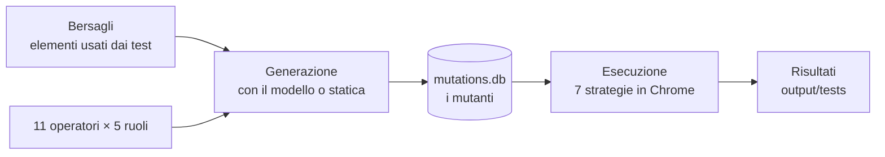

# Automatic Angular E2E Testing Suite

Strumento che genera **mutanti** dell'interfaccia di applicazioni Angular (copie dei template con una sola modifica) e li usa
per misurare quanto sono fragili i locatori dei test End-to-End. Questa versione estende lo strumento di S. Liberti con un
**generatore di mutanti basato su un modello linguistico (LLM)** ed è il materiale software della tesi *Generazione di mutanti
per applicazioni web template-based mediante modelli linguistici di grandi dimensioni* (V. Di Carluccio, Università degli Studi
di Napoli Federico II, A.A. 2025–2026).

**Vuoi usarlo?** I passaggi per scaricare il progetto, creare i mutanti ed eseguirli sono nella **versione dettagliata:
[`GUIDA-RIPRODUZIONE.md`](GUIDA-RIPRODUZIONE.md)**. Se i file `.bat` non partono, gli stessi passi senza `.bat` sono in
[`GUIDA-SENZA-BAT.md`](GUIDA-SENZA-BAT.md).

---

## Che cosa fa

Un test End-to-End trova gli elementi della pagina con un **locatore**. Quando il template cambia, il locatore può smettere di
funzionare e il test fallisce anche se l'applicazione funziona ancora: è la **fragilità**. Per misurarla servono tante modifiche
realistiche dell'interfaccia, ed è quello che produce lo strumento.

Per ogni modifica, cioè per ogni **mutante**, lo strumento controlla se l'applicazione compila ancora e, se compila, fa girare gli
stessi test con **sette strategie di localizzazione**: Absolute, Relative, ROBULA, ROBULA+, Selenium, Katalon e Hook-Based. Così si vede
quali strategie resistono alla modifica e quali no.

I mutanti si possono generare con due tecniche, confrontabili perché lavorano sugli stessi bersagli:

| Tecnica | Come produce la modifica | Dove |
|---|---|---|
| **Statica** | applica regole fisse all'albero HTML | `mutation-generator/static-generator` |
| **Con modello linguistico** | un modello scrive la modifica; lo strumento decide dove e quale | `mutation-generator/llm-generator` |

Il lavoro riguarda tre applicazioni Angular: **CineLib**, **FlowBoard** e **CookBook**.

## Come funziona

1. **I bersagli.** Sono gli elementi su cui agiscono i test dell'applicazione, riconosciuti dal loro attributo `x-test-…`. Stanno nei
   file `role-targets-<app>.json`.
2. **Gli operatori e i ruoli.** Lo schema di mutazione ha **11 operatori** (a–k), definiti in `mutation-types-modello.json`, applicati
   attorno a ogni bersaglio in **5 ruoli**: α il bersaglio, β il padre, γ un antenato, δ un fratello, ε il componente contenitore.
   Quali combinazioni esistono davvero lo calcola lo strumento guardando i template.
3. **La generazione.** Con il modello linguistico, lo strumento prepara un prompt per ogni elemento e il modello scrive solo la
   modifica degli operatori a, b, c, d, e, i, j, k; lo strumento controlla le risposte e produce da programma f, g, h (gli spostamenti).
   Con il generatore statico non servono né prompt né modello. I mutanti finiscono in un database, `mutations.db`.
4. **L'esecuzione.** Per ogni mutante lo strumento inserisce il template mutato nell'applicazione e aspetta la ricompilazione: è qui che
   si scopre se il mutante **compila**. Poi esegue i test con le sette strategie e rimette il template originale.
5. **I risultati.** Per ogni strategia si contano i **successi** (il test passa), le **fragilità** (il test fallisce con quella strategia
   mentre con altre passa) e le **prove sprecate** (falliscono tutte: la modifica ha rotto la funzione e non dice niente sui locatori).

**Chi fa che cosa.** L'**utente** lancia i comandi, lo **strumento** fa tutto il lavoro meccanico, il **modello** (Claude Opus 4.8) scrive
solo le risposte ai prompt.

Dove parte e dove finisce lo strumento, e quali cartelle ne fanno parte, è spiegato in **[`STRUMENTO.md`](STRUMENTO.md)**. I test sono
descritti in **[`TEST.md`](TEST.md)**.

---

## Risultati della tesi
Su tutte e tre le applicazioni il generatore con LLM ha prodotto una quota di mutanti validi più alta di quello statico
(88,0–95,6% contro 72,9–82,3%, cioè da 11,7 a 18,1 punti percentuali in più) e molte meno prove sprecate (1,3–2,8% contro
10,2–24,1%). Gli **8.978 mutanti** delle sei campagne sono consultabili in [`mutazioni-generate/`](mutazioni-generate).

## Contenuto del repository

Ogni cartella dice nel proprio `README.md` se **fa parte dello strumento** o se contiene **dati**. Lo schema completo, con dove
parte e dove finisce lo strumento, è in [`STRUMENTO.md`](STRUMENTO.md).

### LO STRUMENTO (codice)

| Cartella o file | Ruolo |
|---|---|
| [`mutation-generator/`](mutation-generator) | **generazione dei mutanti**: `llm-generator` (con modello linguistico), `static-generator` (regole fisse), `common` (servizi comuni) |
| [`mutation-tester/`](mutation-tester) | **esecuzione dei test** sui mutanti: inserisce il mutante, controlla la ricompilazione, lancia i test, ripristina |
| [`ext-test-classes/`](ext-test-classes), [`vintage-fix/`](vintage-fix) | classi di base dei test (con la preparazione di Chrome) e impostazione di JUnit |
| [`custom-locators/`](custom-locators), [`hook-injector/`](hook-injector) | moduli ereditati dallo strumento originale (locatori ROBULA e ROBULA+; attributi di test, non usato) |
| `pom.xml` | il progetto Maven che compila tutti i moduli |
| `mutanti.ps1`, `esegui_mutanti.py`, `conta_mutanti.py`, `escludi_i_su_bersaglio.py`, `deduplica_statici.py`, `confronta_tecniche.py` | **programma di controllo**: lancia generazione ed esecuzione e mostra i risultati (passi 5-11 della guida) |
| `installa.bat`, `installa.ps1`, `terminale.bat`, `ambiente.ps1`, `configura_percorsi.ps1` | installazione e terminale (passi 3-4 della guida) |

### INGRESSO (descrive un'applicazione allo strumento)

| Cartella o file | Contenuto |
|---|---|
| [`applicazioni-soggetto/`](applicazioni-soggetto) | le tre applicazioni Angular (CineLib, FlowBoard, CookBook) |
| `generator-config-*.json`, `role-targets*.json`, `mutation-types*.json`, `generator-config.json` | configurazione di ogni applicazione e definizione degli 11 operatori |
| `ISTRUZIONI-MODELLO.template.md`, `CLAUDE.md` | istruzioni per il modello e preparazione di un'applicazione nuova |

### USCITA (creata quando si usa lo strumento)

| Cartella | Contenuto |
|---|---|
| `generazione-<nome-applicazione>/`, `generazione-<nome-applicazione>-statico/` | prompt, risposte, database `mutations.db` ed esiti di **una** generazione (la crea `mutanti.ps1`; non è versionata) |

### DATI E RISULTATI DELLA TESI (non sono lo strumento)

| Cartella | Contenuto |
|---|---|
| [`mutazioni-generate/`](mutazioni-generate) | gli 8.978 mutanti delle sei campagne, in forma leggibile |
| `cinelib-v2-run/`, `flowboard-v2-run/`, `cookbook-run/` | campagne con il modello: prompt, risposte, test compilati ed esiti |
| `cinelib-v2-static-run/`, `flowboard-v2-static-run/`, `cookbook-static-run/`, `cookbook-i-bersaglio-run/` | campagne con il generatore statico e i 10 mutanti dell'operatore i sul bersaglio di CookBook |
| `cinelib-v2/`, `flowboard-v2/` | i locatori delle sette strategie e lo script che genera le classi di test |
| [`analisi-risultati/`](analisi-risultati) | script che calcolano le misure del Capitolo 4 |
| [`programmi-di-controllo/`](programmi-di-controllo) | i programmi con cui sono state eseguite le campagne complete della tesi (percorsi del PC originale) |
| [`test-suite/`](test-suite) | test del lavoro precedente su Angular-Spotify |

### GUIDE

[`GUIDA-RIPRODUZIONE.md`](GUIDA-RIPRODUZIONE.md) (versione dettagliata: tutti i passaggi), [`GUIDA-SENZA-BAT.md`](GUIDA-SENZA-BAT.md) (gli stessi passaggi senza `.bat`),
[`STRUMENTO.md`](STRUMENTO.md) (che cos'è lo strumento),
[`TEST.md`](TEST.md) (i test: quali sono, dove stanno, quale test prova quale mutante),
[`RIPRODURRE-LE-CAMPAGNE.md`](RIPRODURRE-LE-CAMPAGNE.md) (campagne complete della tesi),
[`README-STRUMENTO-ORIGINALE.md`](README-STRUMENTO-ORIGINALE.md) (strumento originale), [`archivio/`](archivio) (materiale di lavoro, solo storico).
