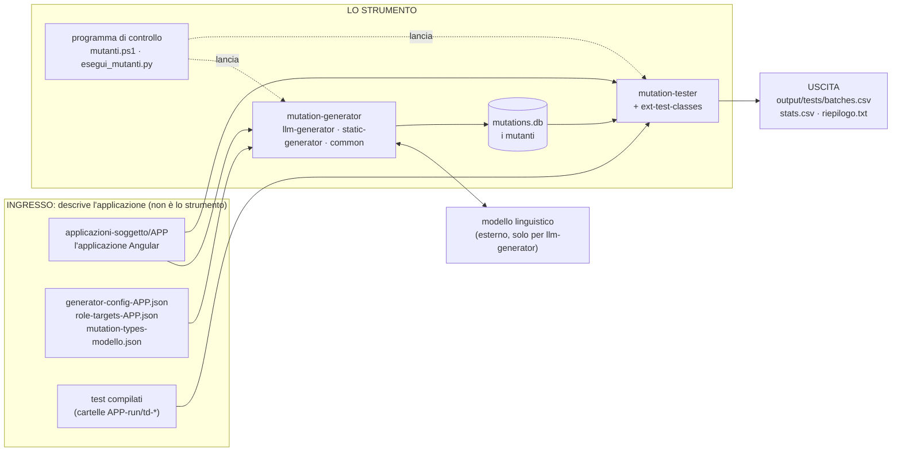

# Lo strumento: che cos'è, dove parte e dove finisce

Questa pagina risponde a tre domande: **quali cartelle di questo repository sono lo strumento**, **da dove parte** e **dove finisce**.
Tutto il resto (applicazioni, dati delle campagne, risultati, archivio) è **materiale**: lo strumento lo legge o lo produce, ma non ne fa parte.

## In una frase

Lo strumento è un progetto **Maven a più moduli** (Java) più un **programma di controllo** (Python). Ha due parti separate:
**generare i mutanti** e **eseguirli con i test**. Tutto ciò che lo rende specifico per un'applicazione sta in file di configurazione
esterni, quindi per usarlo su un'applicazione basta scrivere quei file, senza toccare il codice.

## Il percorso, dall'inizio alla fine

| Fase | Che cosa succede | Dove |
|---|---|---|
| **Parte** | si lancia un generatore con il file di configurazione dell'applicazione (`.\mutanti.ps1 <app> prompt`, che avvia `llm-generator`) | `mutation-generator/` |
| 1. Generazione | il generatore trova gli elementi da mutare nei template, produce le modifiche (il modello linguistico scrive quelle degli operatori a–e, i–k; f, g, h le produce il programma) e le salva | `mutation-generator/` → `mutations.db` |
| 2. Esecuzione | per ogni mutante: scrive il template mutato nell'applicazione, aspetta che il server di sviluppo la **ricompili** (è qui che si verifica se il mutante compila), esegue i test con le sette strategie e ripristina il template | `mutation-tester/`, `ext-test-classes/` |
| **Finisce** | gli esiti di ogni prova e il conteggio per strategia sono scritti in file di tabella | `output/tests/batches.csv`, `stats.csv` (e `riepilogo.txt` con `esegui`) |

Dopo la fine dello strumento c'è solo l'**uso dei risultati** (fuori dallo strumento): `analisi-risultati/` calcola le misure della tesi dagli esiti,
e `mutazioni-generate/` raccoglie i mutanti esportati in forma leggibile.

## Quali cartelle sono lo strumento

| Cartella o file | Ruolo | Provenienza |
|---|---|---|
| `mutation-generator/common` | servizi comuni: indicizzazione dei template, ricerca degli elementi, salvataggio ed esportazione dei mutanti | ereditato, ampliato |
| `mutation-generator/static-generator` | generatore **statico**: modifica l'albero HTML con regole fisse (JSoup) | ereditato, invariato |
| `mutation-generator/llm-generator` | generatore **con modello linguistico**: prepara i prompt, acquisisce le risposte, produce f/g/h | **realizzato in questo lavoro** |
| `mutation-tester` | esecutore dei test: inserisce i mutanti, controlla la ricompilazione, lancia i test | ereditato, invariato |
| `ext-test-classes` | classi di base comuni a tutti i test, compresa la preparazione di Chrome | ereditato |
| `vintage-fix` | impostazione per eseguire i test JUnit con il motore Vintage | di servizio |
| `custom-locators` | calcola i locatori ROBULA e ROBULA+ | ereditato |
| `hook-injector` | aggiunge attributi di test al codice sorgente | ereditato, **non usato** |
| `pom.xml` | il progetto Maven che compila tutti i moduli | ereditato |
| `mutanti.ps1`, `esegui_mutanti.py`, `conta_mutanti.py`, `escludi_i_su_bersaglio.py` | **programma di controllo**: lancia generazione ed esecuzione, sceglie il campione di mutanti, mostra i risultati | **questo lavoro** |
| `installa.bat`, `installa.ps1`, `terminale.bat`, `ambiente.ps1`, `configura_percorsi.ps1` | installazione e terminale: preparano il PC, non sono la logica dello strumento | questo lavoro |
| `programmi-di-controllo/` | gli stessi compiti, nella versione delle campagne complete della tesi (percorsi del PC originale) | questo lavoro |

## Che cosa NON è lo strumento

| Cartella o file | Che cos'è |
|---|---|
| `applicazioni-soggetto/` | le tre applicazioni Angular su cui si lavora (CineLib, FlowBoard, CookBook) |
| `generator-config-*.json`, `role-targets*.json`, `mutation-types*.json` | i file che **descrivono un'applicazione** allo strumento (ingresso) |
| `cinelib-v2-run/`, `flowboard-v2-run/`, `cookbook-run/` | dati delle campagne con il modello: prompt, risposte, test compilati, esiti |
| `cinelib-v2-static-run/`, `flowboard-v2-static-run/`, `cookbook-static-run/`, `cookbook-i-bersaglio-run/` | dati delle campagne con il generatore statico e dei mutanti «i» sul bersaglio |
| `cinelib-v2/`, `flowboard-v2/` | i locatori delle sette strategie e lo script che genera le classi di test |
| `generazione-<app>/` | creata da `mutanti.ps1` quando si usa lo strumento: prompt, risposte, database e risultati di **una** generazione (non è versionata) |
| `mutazioni-generate/` | gli 8.978 mutanti delle campagne, esportati in forma leggibile |
| `analisi-risultati/` | calcolo delle misure della tesi dagli esiti |
| `test-suite/` | test del lavoro precedente su Angular-Spotify |
| `archivio/` | materiale di lavoro e campagne di luglio 2026, solo come storico |

## Dove stanno le cose quando si usa

- **Il codice dello strumento** si compila una volta (`installa.bat` lo fa) e produce tre jar: `mutation-generator/llm-generator/target/...`,
  `mutation-generator/static-generator/target/...`, `mutation-tester/target/...`.
- **Ogni generazione** vive in una propria cartella `generazione-<app>/`: lì dentro nascono `mutations.db` e `output/`.
  Si può cancellare e rifare senza toccare lo strumento.
- **Le applicazioni** non vengono mai modificate in modo permanente: ogni mutante è inserito, provato e subito rimesso a posto.
